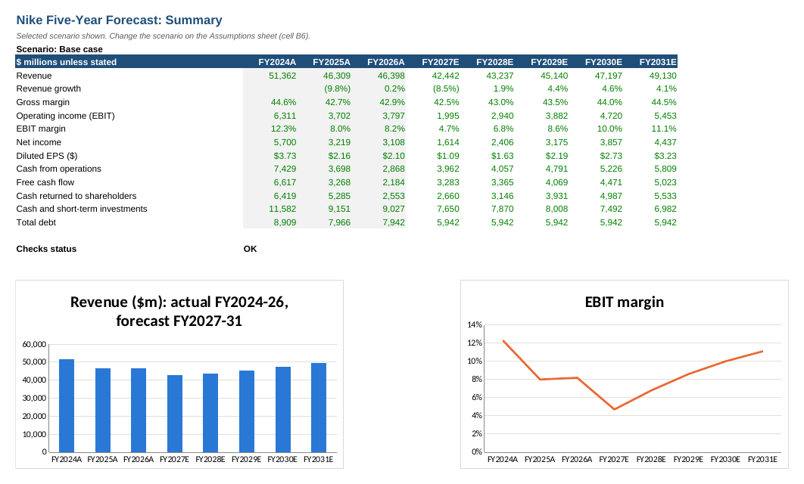
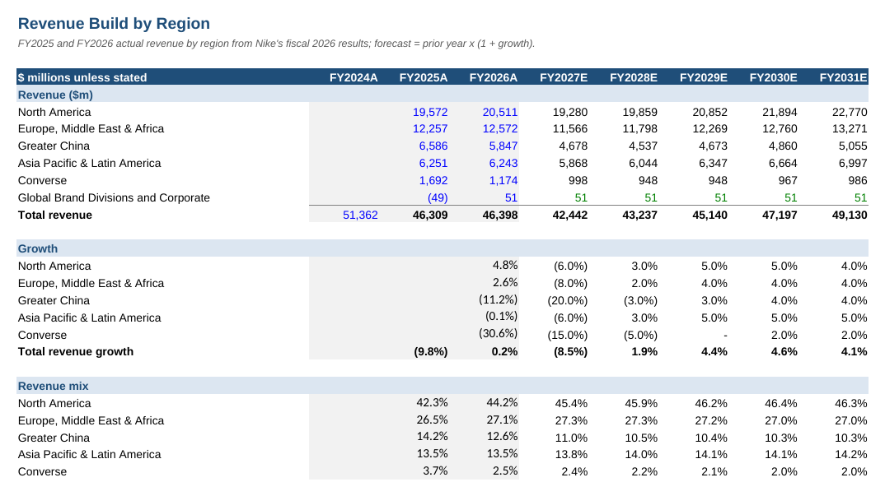
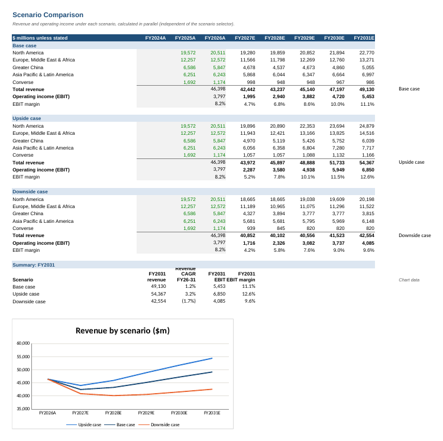

# Nike Five-Year Financial Forecast (Three-Statement Model)

A fully linked income statement, balance sheet and cash flow forecast for NIKE, Inc., built in Excel from its reported 10-K results. It projects five years (FY2027 to FY2031) with a revenue build by region and base, upside and downside scenarios.

**Downloads:** [⬇ Excel model](https://github.com/MuhammedAnshajK/three-statement-model/raw/main/nike_forecast_model.xlsx) · [⬇ PDF version](https://github.com/MuhammedAnshajK/three-statement-model/raw/main/nike_forecast_model.pdf) · [⬇ Python script](https://github.com/MuhammedAnshajK/three-statement-model/raw/main/build_model.py)

## What this does

The model starts from Nike's actual results for FY2024 to FY2026 (years ending 31 May) and forecasts FY2027 to FY2031. Revenue is built region by region, costs and working capital are driven by ratios and days, and cash comes out of the cash flow statement into the balance sheet. Every forecast number is a formula driven by one Assumptions sheet, so one change, such as Greater China growth or inventory days, flows through all three statements.

**Base case result:** FY2027 is set to match Nike's guidance from 1 October 2026: revenue falls 8.5% to $42.4bn (Greater China down 20%) and diluted EPS drops to $1.09 after restructuring costs. Revenue then recovers to $49.1bn by FY2031 and the operating (EBIT) margin rebuilds from 4.7% to 11.1%, with EPS reaching $3.23. Free cash flow of $3.3bn to $5.0bn a year covers the dividend, a smaller buyback programme and $2bn of debt repayment, while cash and short-term investments stay near $7bn to $8bn.

## Scenarios (FY2031)

| Scenario | Revenue | Growth a year (FY26 to FY31) | EBIT | EBIT margin |
|---|---|---|---|---|
| Upside | $54.4bn | 3.2% | $6.9bn | 12.6% |
| Base | $49.1bn | 1.2% | $5.5bn | 11.1% |
| Downside | $42.6bn | (1.7%) | $4.1bn | 9.6% |

The upside assumes a milder FY2027 decline, then a faster recovery in North America and Greater China with gross margin returning to 46%. The downside assumes a deeper FY2027 fall, Greater China and Converse shrinking for longer and gross margin stuck near 42% to 43%.

## Data

- **History:** income statement, balance sheet and cash flow from Nike's 10-K filings for FY2024, FY2025 and FY2026 (SEC EDGAR). Smaller lines are grouped; totals agree to the filings, which the Checks sheet confirms.
- **Revenue by region:** North America, Europe Middle East & Africa, Greater China, Asia Pacific & Latin America, and Converse, from Nike's fiscal 2026 results release.
- **Forecast:** FY2027 total revenue and EPS are anchored to Nike's guidance (Q1 FY2027 results, 1 October 2026). The split by region and FY2028 to FY2031 are my own assumptions.

## Approach

1. **Assumptions sheet.** Growth by region for three scenarios, gross margin, demand creation and overhead as a percentage of revenue, D&A, capex, tax, interest, working capital days, and capital allocation (debt repayment, dividend growth, buybacks). Cell B6 selects the scenario.
2. **Revenue build.** Each region grows from its FY2026 actual by its own rate. The sheet also shows growth and revenue mix by region.
3. **Income statement.** Gross profit from the gross margin, then demand creation (marketing) and operating overhead. Interest uses opening debt and opening cash, which avoids a circular reference.
4. **Balance sheet.** Receivables, inventory and payables come from working capital days. Debt falls by the scheduled repayment. Equity rolls forward with net income, dividends, buybacks and share-based pay.
5. **Cash flow statement.** Indirect method: net income, add back D&A and share-based pay, adjust for working capital, then capex, debt, dividends and buybacks. Closing cash feeds the balance sheet.
6. **Scenarios sheet.** All three scenarios calculated side by side, with a chart, so they can be compared without switching the selector.
7. **Checks.** Balance sheet balances, cash agrees, revenue build agrees, history agrees to the 10-K, and cash stays positive, for every year.

## Key assumptions (base case)

| Driver | FY2027E | FY2031E |
|---|---|---|
| Revenue growth: North America | (6.0%) | 4.0% |
| Revenue growth: Greater China | (20.0%) | 4.0% |
| Gross margin | 42.5% | 44.5% |
| Demand creation (% of revenue) | 10.5% | 9.6% |
| Operating overhead (% of revenue) | 27.3% | 23.8% |
| Inventory days | 100 | 95 |
| Tax rate | 19% | 19% |
| Share buybacks ($m) | 250 | 3,000 |

## Screenshots

| Revenue build | Income statement | Scenarios |
|---|---|---|
|  |  |  |

| Balance sheet | Cash flow |
|---|---|
|  |  |

## How to use

1. Download `nike_forecast_model.xlsx` using the button at the top.
2. Open the **Assumptions** sheet and change any **blue** or **yellow** cell.
3. Change cell B6 to 1 (Base), 2 (Upside) or 3 (Downside).
4. Check the **Checks** sheet still says **OK**.

Colour key: blue = hardcoded input, black = formula, green = link to another sheet, yellow = key assumption.

## Files

- `nike_forecast_model.xlsx`: the full model (Cover, Summary, Assumptions, Revenue Build, Income Statement, Balance Sheet, Cash Flow, Scenarios, Checks)
- `nike_forecast_model.pdf`: print-ready PDF of every sheet, for viewing without Excel
- `build_model.py`: Python script (openpyxl) that generates the workbook, so the model is reproducible
- `images/`: screenshots

## Tools

Excel, Python (openpyxl)

*This is a learning project. It is not investment advice.*
