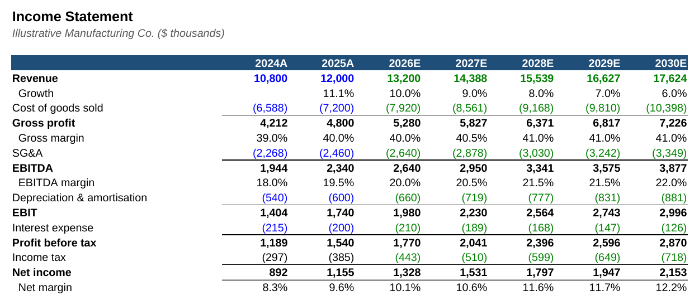
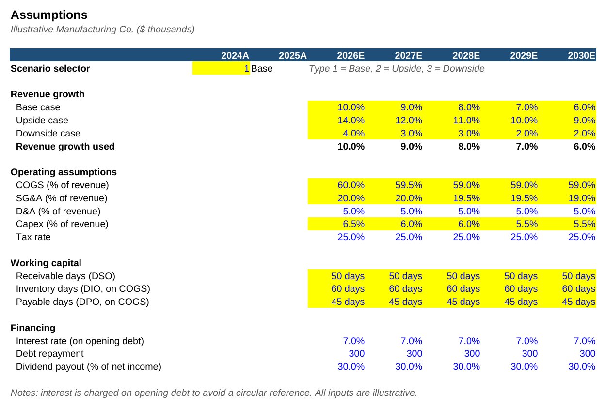
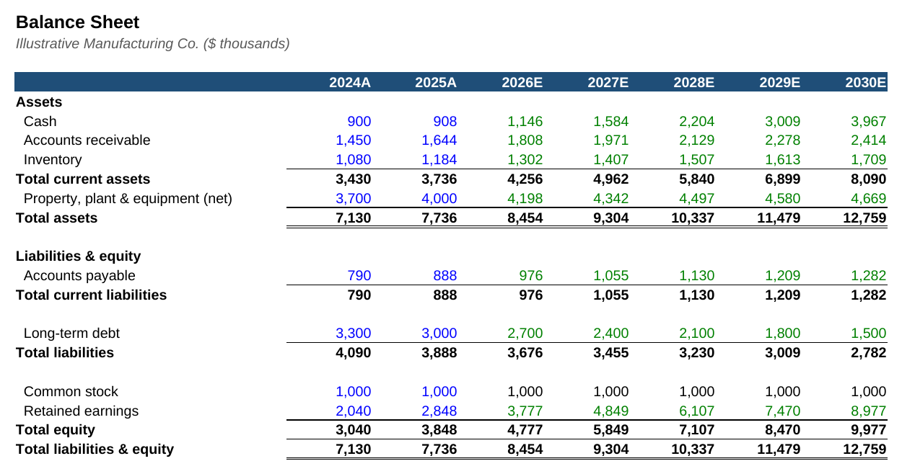
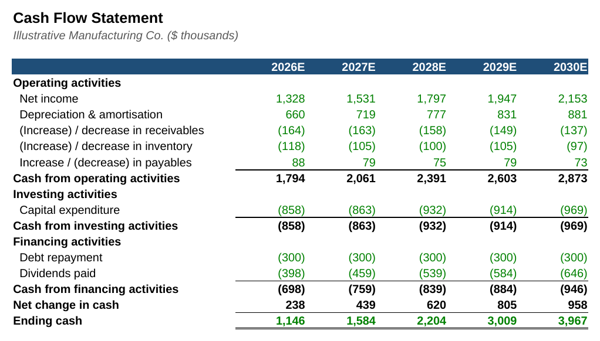

# Three-Statement Financial Model

A fully linked income statement, balance sheet and cash flow forecast for an illustrative manufacturing company, built in Excel with base, upside and downside scenarios.

## What this does

The model forecasts five years (2026 to 2030) from two years of historical results. Every forecast number is a formula driven by one assumptions sheet, so changing a single input, such as revenue growth or receivable days, flows through all three statements. The balance sheet balances in every year and every scenario, which is checked automatically.

**Base case result:** revenue grows from $12.0m to $17.6m, net margin improves from 9.6% to 12.2%, and debt falls from $3.0m to $1.5m while cash builds to $4.0m.

## Data

All figures are illustrative, for a fictional company, and are in $ thousands. No real company or client data is used.

## Approach

1. **Assumptions sheet.** Each driver sits in its own labelled cell for each year: revenue growth (three scenarios), cost ratios, capex, tax, working capital days, interest rate, debt repayment and dividend payout. A scenario selector (1, 2 or 3) picks which growth case the model uses.
2. **Income statement.** Revenue grows by the selected rate. Costs, D&A and tax are driven by their ratios. Interest is charged on the opening debt balance, which avoids a circular reference.
3. **Balance sheet.** Receivables, inventory and payables come from working capital days. PP&E rolls forward as opening balance plus capex minus D&A. Debt falls by the scheduled repayment. Retained earnings roll forward as opening balance plus net income minus dividends.
4. **Cash flow statement.** Built with the indirect method: net income, add back D&A, adjust for changes in working capital, then subtract capex, debt repayment and dividends.
5. **Linking and checks.** Ending cash from the cash flow statement feeds the balance sheet cash line. The Checks sheet confirms that assets equal liabilities plus equity and that both cash figures match, for every year.

## Key assumptions (base case)

| Driver | 2026E | 2030E |
|---|---|---|
| Revenue growth | 10.0% | 6.0% |
| COGS (% of revenue) | 60.0% | 59.0% |
| SG&A (% of revenue) | 20.0% | 19.0% |
| Capex (% of revenue) | 6.5% | 5.5% |
| Receivable / inventory / payable days | 50 / 60 / 45 | 50 / 60 / 45 |
| Interest rate on debt | 7.0% | 7.0% |
| Dividend payout | 30% | 30% |

## Screenshots

| Assumptions | Balance sheet | Cash flow |
|---|---|---|
|  |  |  |

## How to use

1. Download `three_statement_model.xlsx` (click the file, then the download button).
2. Open the **Assumptions** sheet and change any **blue** or **yellow** cell.
3. Change the scenario cell to 1 (Base), 2 (Upside) or 3 (Downside).
4. Check the **Checks** sheet still says **OK**.

Colour key: blue = hardcoded input, black = formula, green = link to another sheet, yellow = key assumption.

## Files

- `three_statement_model.xlsx`: the full model (Cover, Assumptions, Income Statement, Balance Sheet, Cash Flow, Checks)
- `build_model.py`: Python script (openpyxl) that generates the workbook, so the model structure is reproducible
- `images/`: screenshots

## Tools

Excel, Python (openpyxl)
